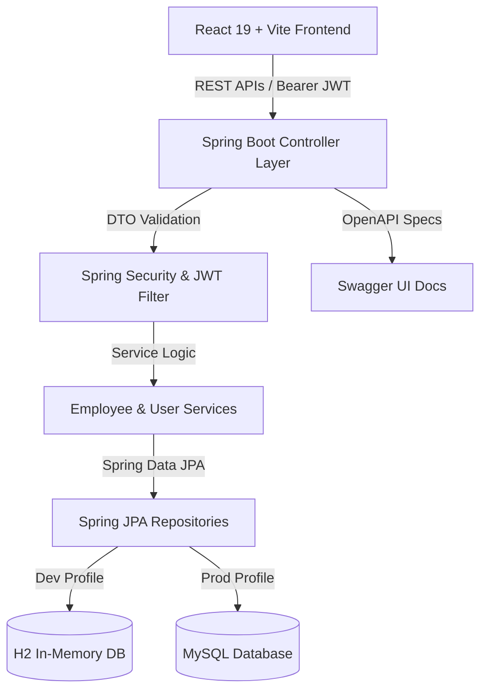

# 🏢 NexusEMS - Enterprise Employee & Workforce Management System

[](https://spring.io/projects/spring-boot)
[](https://react.dev)
[](https://vitejs.dev/)
[](https://www.docker.com/)
[](http://localhost:8080/swagger-ui.html)
[](LICENSE)

A full-stack, enterprise-grade Employee Management System featuring **Nexus AI Workforce Copilot**, **Admin & Manager Control Hub**, **Employee Self-Service Portal**, **Official Internal Communications Hub**, **Executive Analytics Dashboard**, **JWT Authentication & Role-Based Authorization**, **17 Automated JUnit 5 Tests**, **Interactive OpenAPI 3.0 Documentation**, and **Docker Containerization**.

---

## 🌟 Key Features & Highlights

### 🤖 Nexus AI Workforce Copilot
* **Natural Language Queries**: Ask for real-time details about any colleague (*"Give me details about Sarah Connor"*), department rosters (*"Show Engineering headcount"*), or leave status (*"Who is on leave?"*).
* **HR Policy Assistant**: Instant answers for annual paid vacation, sick leave, remote work guidelines, and benefits.
* **Document Synthesis**: Generate official corporate announcements, team townhall notices, and employee performance summaries.
* **Full-Page & Floating Widget**: Accessible both as a dedicated AI Assistant tab and as a floating bottom-right copilot widget across all views.

### 👑 Admin & Manager Control Hub (`/admin`)
* **KPI Metrics**: Real-time staff count, active on-duty percentage, approved PTO/leave counts, and annual payroll expense.
* **Comprehensive Oversight**: Search, department filtering, status toggling, compensation adjustments, and CSV report exports.

### 👤 Employee Self-Service Portal (`/my-profile`)
* **Personal Profile Editing**: Employees can edit their phone number, avatar URL, professional bio, core skills tags, emergency contact, and residential address.
* **Security & Tamper Protection**: Sensitive corporate records (salary, designation, department, employment status) are strictly locked and cannot be altered by employees.

### 💬 Official Internal Communications Hub (`/communication`)
* **Department Broadcast Channels**: `#general-announcements`, `#engineering-team`, `#human-resources`, `#product-design`, and `#finance-approvals`.
* **Direct 1-on-1 Messages**: Encrypted, logged official direct messaging with online status indicators.
* **Official Category Tagging**: Categorize messages as `General`, `Urgent`, `Project Update`, `HR Inquiry`, or `Corporate Notice`.

### 📊 Executive Analytics Dashboard
* **Workforce KPIs**: Real-time stats on Total Staff Count, Active Status percentages, Department counts, and Total Monthly Payroll expense calculations.
* **Department Distribution Charts**: Visual salary and headcount distribution progress indicators per department.
* **Recent Onboarding Activity Feed**: Chronological list of latest employee additions with avatar indicators and status tags.

### 👥 Comprehensive Employee Directory
* **Search & Multi-field Filtering**: Instant search across name, email, role, and department. Filter by Department pills and Employment Status (Active vs On Leave).
* **Sorting & Views Switcher**: Toggle between a **Glassmorphic Grid Card View** and a **Compact Data Table View**. Sort records dynamically by Name, Salary, or Joining Date.
* **Modal Profile Details**: Expandable glassmorphic modal displaying full employee contact card, salary badge, verified status, and department metadata.
* **One-Click CSV Export**: Stream and download full workforce records into a CSV file report.

### 🔐 Security & Database Engineering
* **JWT Authentication**: Secure stateless token issuance (`/login` & `/register`) with BCrypt password hashing and Spring Security filter chains.
* **Role-Based Access Control**: Distinguishes `ROLE_ADMIN`, `ROLE_MANAGER`, and `ROLE_EMPLOYEE`.
* **Dual Database Mode (Zero-Config Testing)**:
  * **H2 In-Memory DB Profile**: Zero-setup plug-and-play mode with pre-seeded mock dataset (`DataInitializer`) for instant reviewer evaluation.
  * **MySQL Enterprise Profile**: Production-ready MySQL configuration.
* **OpenAPI 3.0 / Swagger UI Integration**: Live, interactive API documentation accessible at `/swagger-ui.html`.
* **Automated JUnit 5 Test Suite**: 17 comprehensive unit and integration tests passing green.

---

## 📐 System Architecture



---

## 🛠️ Technology Stack

### **Frontend**
* **Framework**: React.js 19, Vite
* **Routing & State**: React Router DOM v7, Context API (`AuthContext`)
* **Styling**: Modern Glassmorphism CSS design system, Bootstrap 5
* **Icons & Notifications**: Lucide React, React Toastify
* **HTTP Client**: Axios with Bearer token request interceptor

### **Backend**
* **Framework**: Java 17, Spring Boot
* **Security**: Spring Security, JJWT (JSON Web Token 0.12.5), BCrypt Password Encoder
* **Persistence**: Spring Data JPA, Hibernate, H2 Database / MySQL
* **Documentation**: Springdoc OpenAPI 3.0 / Swagger UI
* **Validation**: JSR-303 Validation (`@NotBlank`, `@Email`, `@Positive`)

### **DevOps & Containerization**
* **Docker & Docker Compose**: Multi-stage build containers for Spring Boot, Nginx React frontend, and MySQL 8.0.
* **CI Pipeline**: GitHub Actions workflow (`.github/workflows/ci.yml`).

---

## 🚀 Quick Start Guide

### Option 1: Standalone Frontend Demo (No Installation Required)
```bash
cd ReactForEmployee/Employee-Management-System
npm install
npm run dev
```
Open `http://localhost:5173` in your browser. The app runs with interactive mock data out of the box!

---

### Option 2: Full-Stack Local Execution (Spring Boot + H2/MySQL + React)

#### 1. Start Spring Boot Backend
```bash
cd EmployeeManagementCRUD
# Run using Maven Wrapper (auto-creates H2 database and pre-seeds demo employees)
.\mvnw.cmd spring-boot:run
```
* **Backend API Base**: `http://localhost:8080`
* **Swagger UI API Docs**: `http://localhost:8080/swagger-ui.html`
* **H2 Database Console**: `http://localhost:8080/h2-console` (JDBC URL: `jdbc:h2:mem:employeedb`, User: `sa`, Password: blank)
* **Default Admin Account**: Username: `admin` | Password: `admin123`

#### 2. Start React Frontend
```bash
cd ReactForEmployee/Employee-Management-System
npm install
npm run dev
```

---

### Option 3: One-Command Docker Setup 🐳
To spin up MySQL 8.0, Spring Boot Backend, and Nginx React Frontend simultaneously:
```bash
docker-compose up --build
```
* Frontend: `http://localhost:5173`
* Backend: `http://localhost:8080`
* Swagger API Docs: `http://localhost:8080/swagger-ui.html`

---

## 📡 Key REST API Endpoints

### 🔐 Authentication (`/`)
| Method | Endpoint | Description |
| :--- | :--- | :--- |
| `POST` | `/register` | Register new user account and receive JWT |
| `POST` | `/login` | Authenticate credentials and receive Bearer Token |
| `GET` | `/users` | Get registered users list |

### 👥 Employee Operations (`/employee`)
| Method | Endpoint | Description |
| :--- | :--- | :--- |
| `GET` | `/employee/all` | Fetch all employee records |
| `GET` | `/employee/paged` | Get paginated, searchable, and filtered employees |
| `GET` | `/employee/{id}` | Fetch single employee details by ID |
| `POST` | `/employee/add` | Create new employee with validation |
| `PUT` | `/employee/update` | Update existing employee record |
| `DELETE` | `/employee/delete/{id}` | Remove employee by ID |
| `GET` | `/employee/stats` | Fetch Dashboard KPI analytics |
| `GET` | `/employee/export/csv` | Download workforce records as CSV |

---

## 🌐 Deploy to Render (Public Cloud Deployment)

NexusEMS is cloud-ready and configured for deployment on [Render](https://render.com/).

### Method 1: Using `render.yaml` Blueprint (Automated)
1. Push your latest code to your GitHub repository.
2. Log into [Render Dashboard](https://dashboard.render.com/).
3. Click **New +** → **Blueprint**.
4. Connect your `Employee_Management-System` repository.
5. Render will automatically detect `render.yaml` and configure both services:
   - **`ems-backend`**: Docker Web Service (Spring Boot 3 + H2 In-Memory DB).
   - **`ems-frontend`**: Static Site (React 19 + Vite with SPA rewrite rules).
6. Set the `VITE_API_BASE_URL` environment variable on the frontend to your backend Render URL (e.g., `https://ems-backend-xxxx.onrender.com`).
7. Click **Apply** to deploy!

### Method 2: Manual Dashboard Deployment

#### 1. Deploy Backend Web Service
* **Service Type**: Web Service
* **Runtime**: Docker
* **Root Directory**: `EmployeeManagementCRUD`
* **Dockerfile Path**: `Dockerfile`
* **Instance Type**: Free
* **Environment Variables**:
  * `PORT` = `8080`
  * `SPRING_PROFILES_ACTIVE` = `default` (H2 zero-config DB pre-seeded with admin: `admin` / `admin123`)
* Copy the deployed backend URL (e.g. `https://ems-backend.onrender.com`).

#### 2. Deploy Frontend Static Site
* **Service Type**: Static Site
* **Root Directory**: `ReactForEmployee/Employee-Management-System`
* **Build Command**: `npm install && npm run build`
* **Publish Directory**: `dist`
* **Redirects / Rewrites**:
  * Source: `/*`
  * Destination: `/index.html`
  * Action: `Rewrite`
* **Environment Variables**:
  * `VITE_API_BASE_URL` = `https://<your-backend-app-name>.onrender.com`

---

## 👨‍💻 Author

**Sudarshan Bhat**  
* GitHub: [@sudubhat23](https://github.com/sudubhat23)  
* Tech Stack: Java, Spring Boot, React.js, Full Stack Development
